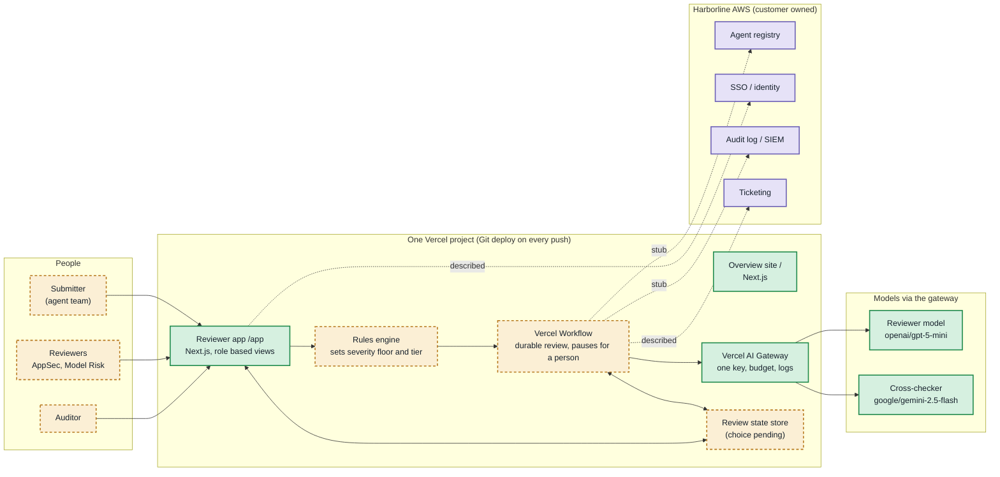
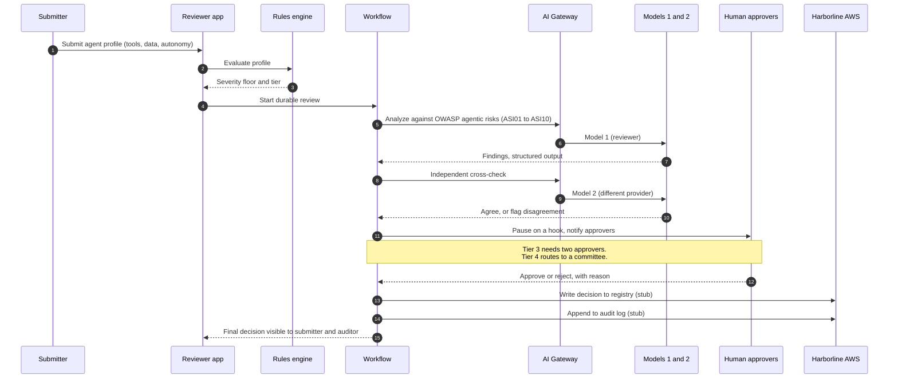

# AI Agent Security Posture Review Workflow

A security review workflow for internal AI agents at Harborline Financial Group, a fictional global bank and insurer. Each agent is checked by rules and two AI models, then a recorded human decision is required before it can launch, cutting a manual review that takes about 15 business days.

Live site: https://ai-agent-security-posture-review.vercel.app (reviewer app: https://ai-agent-security-posture-review.vercel.app/app)

Diagram key: green is built, amber dashed is planned, and purple is the customer's own AWS.

## Architecture

System view.

One Tier 3 review, step by step.

The review state store is still undecided.
