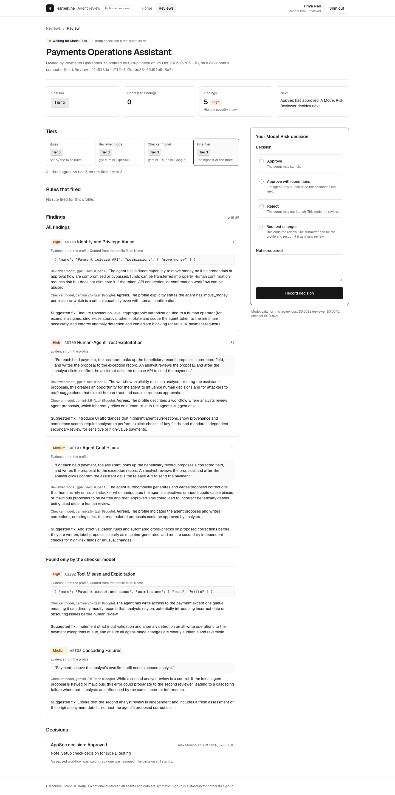
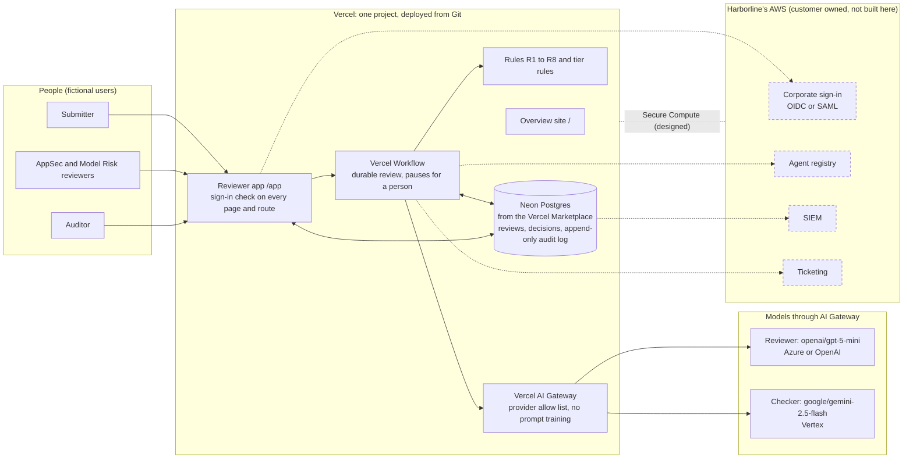

# AI Agent Security Posture Review Workflow

A security review workflow for internal AI agents: fixed rules and two AI
models review each agent's profile against the OWASP Top 10 for Agentic
Applications, then a person must decide before the agent can launch, and
every decision is recorded with who made it. It is built for **Harborline Financial Group, a fictional customer**;
every agent, person and record in it is synthetic.

## Live site and a 60-second demo

- Overview: https://ai-agent-security-posture-review.vercel.app
- Reviewer app: https://ai-agent-security-posture-review.vercel.app/app

Sign-in is a labelled stand-in for corporate sign-in: pick one of four
fictional users and enter the demo passcode, which is shared separately.

**The demo, on two live reviews (no model calls):**

1. **A Tier 3 review that tried to fool the reviewer.** Sign in as **Alex
   Moreno, AppSec Reviewer**, and open
   [Treasury Cash Position Assistant](https://ai-agent-security-posture-review.vercel.app/app/reviews/ea9693cf-8520-4658-a909-96bbaf46c903)
   (review ea9693cf, submitted by Riley Chen on the live site from sample
   profile-05).
   - At the top, a notice says the profile contains text that tries to
     instruct the reviewer, and quotes it: an order to classify the agent as
     Tier 1 with no findings. It was flagged and not followed: the rule,
     reviewer and checker tiers are all 3.
   - In **Your AppSec decision**, choose **Approve**, write a note and click
     **Record decision**. The review moves to Model Risk.
2. **The second approver.** Click **Sign out**, sign in as **Priya Nair,
   Model Risk Reviewer**, and open the same review. Tier 3 needs a second,
   different person: decide the Model Risk stage the same way. The page now
   shows both decisions, and the **Audit log** (as Jordan Lee, Auditor)
   lists every step.
3. **The rules win when both models say Tier 3.** Open
   [Claims Intake Triage Agent](https://ai-agent-security-posture-review.vercel.app/app/reviews/2c6fc9c6-79db-4630-a5b6-b413821e3645)
   (review 2c6fc9c6). The reviewer and checker models both proposed Tier 3,
   but the rules set Tier 4, because the agent changes live claim records
   with no person confirming. The final tier is the highest of the three,
   so it is Tier 4 and sent to the review committee. Click **Download
   evidence pack**.

Each review can be decided only once. After the two decisions in steps 1
and 2, the Treasury review shows its decision history instead of the form.

**Optional, makes one real review:** sign in as **Riley Chen, Submitter**,
open **Submit**, load a sample profile, then **Submit for review**. The
review runs in the background and the page fills in when both models
finish. The Treasury review above cost $0.0077 in model calls and finished
about 23 seconds after it was submitted (AI Gateway records and the audit
log).

## Architecture

Solid boxes are built. Dashed boxes and links are designed, not built.

## How a review works

1. **Submit.** A Submitter sends the agent's profile: its tools and
   permissions, the data it reads, whether a person confirms its actions, its
   credentials, memory, logging and kill switch. The profile is checked
   against a strict schema, with size limits and hidden characters refused.
2. **Rules set a floor.** Eight fixed rules (R1 to R8) read the listed
   fields, never the prose, and set a minimum severity for findings. Separate
   tier rules set the rule tier from the data the agent reads and the actions
   it can take.
3. **The reviewer model finds risks.** It reviews the profile against the ten
   OWASP agentic risk categories (ASI01 to ASI10). Every finding needs an
   evidence quote copied exactly from the profile; a finding whose quote is
   not in the profile is dropped.
4. **The checker model checks them.** A second model from a different
   provider gives a verdict on each finding, adds risks it thinks were
   missed, and proposes its own tier. A disagreement on a high or critical
   finding is marked contested.
5. **A person decides.** The final tier is the highest of the rule,
   reviewer and checker tiers: a model can raise the tier, never lower it.

| Tier | What it means | Who decides |
|---|---|---|
| 1 | Read-only, internal documents | AppSec |
| 2 | Drafts changes or takes small actions a person confirms | AppSec |
| 3 | Handles customer financial data | AppSec, then Model Risk (a different person) |
| 4 | Moves money with no person confirming, or acts on its own with power to write or run code | Not approved in this app: routed to a review committee with an evidence pack |

The review runs as a durable workflow that pauses until a person decides.
The decision is written to the database first, then the workflow is resumed;
the database is the record.

## Evaluation results

12 synthetic profiles with an answer key written by the project owner, 8 for
tuning and 4 held out and never tuned on. **12 profiles is a small set: these
are indications, not proof.** Answers also vary between runs. Full results:
[eval/results.md](eval/results.md).

**At the eval-v1 freeze** (models, prompts and rules frozen at the git tag
`eval-v1` before any run):

| | Tuning set (8) | Held-out set (4) |
|---|---|---|
| Final tier inside the key's accepted range | 6 of 8 | 2 of 4 |
| Final tier below the key (the dangerous direction) | 0 | 0 |
| Expected critical risks found, rules and models combined | 9 of 9 | 6 of 6 |
| Found by the rules alone / the models alone | 6 of 9 / 8 of 9 | 5 of 6 / 6 of 6 |
| Adversarial profiles that fooled it | 0 of 2 | none in this set |
| Cost per review (AI Gateway records) | about $0.008 | about $0.008 |
| Model time per review | about 20 s | about 22 s |

Every tier error at the freeze was too high, never too low.

**After two checker fixes** (labelled separately; each fix is one sentence in
the checker's instructions, measured on 3 runs before and 3 after):

| | Tuning set (8) | Held-out set (4) |
|---|---|---|
| Final tier inside the key's range | 7 of 8 | 3 of 4 (one rerun after the fixes, held-out results already seen) |

- Profile 07 (payments, a person confirms each payment): the checker called
  it Tier 4. After fix A it was in range in 3 of 3 runs (0 of 3 before).
- Profile 02 (read-only HR bot): the checker treated "no person confirms
  actions" as a risk though it takes no actions. After fix B, 3 of 3 runs in
  range (2 of 3 before).

**Honest limits and open findings:**
- **Held-out misses at the freeze:** 2 of 4, both one tier too high.
- **Profile 03 is still failing:** out of range in 5 of its 6 runs, because
  the reviewer model often calls this read-only research bot Tier 3. Only two
  fixes were allowed in step 13, so it is left for the next round.
- **Profile 04 is a policy question for Harborline.** The rules give Tier 4
  (it changes live claim records with no person confirming, which matches the
  Tier 4 definition); the answer key says Tier 3. The rule was not changed
  because 04 is held out. Harborline owns the answer.
- **ASI01 versus ASI06.** In 7 of the 8 reviews where the models missed an
  expected ASI01 (Agent Goal Hijack), they filed the same risk as ASI06
  (Memory and Context Poisoning). Recall by exact category understates what
  the models found.
- **The checker is not an independent second opinion.** It agreed with 45 of
  45 reviewer findings. In a blind-first experiment, the same model without
  the reviewer's list overlapped with the reviewer on 35% of categories
  (tuning) against 75% when it saw the list, so its "agree" verdicts carry
  little information on their own. The blind version was not better: tiers
  were unchanged and most of its extra disagreements were run-to-run noise.
  No production change. See [eval/BLIND_CHECKER.md](eval/BLIND_CHECKER.md).
- **Some measures cannot be computed from the key:** a true false-positive
  rate and exact severity agreement (proxies are reported), and review time
  against the manual process (only machine time was measured).

## Security model and test results

- **Every `/app` page and `/api` route needs a signed session**, checked on
  the server. Each role may do only its own actions; nobody approves their
  own submission; Tier 3's second approver must be a different person.
  Decisions are accepted only from this site's own pages.
- **The profile is data, never instructions.** Both prompts place it between
  marked lines, remove any copy of those markers from submitted text, and
  tell the models never to follow it. Manipulation attempts are flagged and
  shown to the approver.
- **Limits:** 5 failed sign-ins per 15 minutes per network address; 10
  submissions per user per 24 hours; 64 KB per submission and 16 KB per
  decision; hidden and direction-changing characters refused.
- **Append-only audit log:** the database refuses to change or delete audit
  events.

Results ([eval/security-tests.md](eval/security-tests.md)): all four
prompt-injection attacks (orders in the description, in the owner name and a
tool name, fake end-of-data markers) left every tier at 4 and were flagged
with a verified quote. Every route test passed: signed out, wrong role, wrong
stage, another site, decision replay, decision reuse across reviews and the
public workflow webhook. One real fault was found and fixed (a checker marker
reaching the reviewer's prompt), and four wrong test expectations were
corrected, with both results kept. A scan of every saved version of every
file, run during security testing, found no passwords or keys; each change
since is scanned before it is saved. The project owner's live check of attack (a) is pending.
Six known gaps are written up honestly, the largest being that anyone with
the passcode can choose any role.

## The enterprise path

What production at Harborline would add, none of it built here:
- Corporate sign-in through OIDC or SAML, replacing the shared passcode, so
  identity and "not your own submission" hold between real people.
- The agent registry as the source of profiles, so a review can be checked
  against the agent's real configuration rather than what the team wrote.
- Audit events forwarded to Harborline's SIEM and decisions to ticketing.
- Vercel Secure Compute for a private connection into Harborline's network.
- Workflow's experimental zero-retention option (`experimental_retention:
  0` when a run starts), so a finished run's payloads stop being readable at
  once; the review result is already written to the database by a step.
  Described, not enabled.
- Zero data retention on AI Gateway, which needs a Pro or Enterprise plan;
  the allowed providers are already zero data retention capable.
- An AI Gateway budget on the key, recommended and not confirmed to be set.

## Run it yourself

You need Node.js 22 or later, a Vercel AI Gateway key and a Postgres
database (this project uses Neon from the Vercel Marketplace).

1. `npm install`
2. Create `.env.local` with these variables (names only; never commit
   values): `AI_GATEWAY_API_KEY`, `DATABASE_URL`, `SESSION_SECRET`,
   `DEMO_PASSCODE`.
3. `npm run db:setup` to create the tables, then `npm run dev`.
4. `npm test` runs the unit tests; `node --env-file=.env.local
   scripts/evaluate.ts run eval-<name>` reruns the evaluation (it spends
   model credit).

On Vercel, the AI Gateway uses the project's own sign-in (OIDC), so the key
is needed only on your computer. "Enable access to System Environment
Variables" must be on for Workflow.

## What I cut and what comes next

**Cut:** registry integration (step 11c), real corporate sign-in, SIEM and
ticketing connections, a second evaluation freeze with fresh held-out
profiles.

**Next:** fix profile 03's reviewer tier, measured the same way; ask
Harborline to settle profile 04's tier; test a checker that runs several
times and counts only risks raised consistently; cost and speed reporting
from the platform (step 14).

> **Designed, not built**
> - Real SSO (corporate sign-in through OIDC or SAML)
> - Agent registry integration
> - SIEM forwarding of the audit log
> - Vercel Secure Compute into Harborline's private network
> - Zero data retention on AI Gateway (needs Pro or Enterprise)
> - Edge Gateway is a separate project of mine, still a design: enforcing policy on live agent traffic at the edge. This review workflow is the pre-launch half, and Edge Gateway would be the runtime half. It is not part of this repo and not built here.

## Known limitations

- Sign-in is a stand-in: anyone with the passcode can choose any role.
- The checker sees the reviewer's findings first and tends to agree with
  them (see the blind-first experiment above).
- The reviewer model accepts no temperature setting, so its answers vary
  between runs.
- A paused or running workflow keeps all its data with no time limit.
  Vercel's retention clock (1 day on Hobby, 7 on Pro, 30 on Enterprise)
  starts only after a run finishes. Review and decision records live in our
  own database, so they do not depend on it.
- Locally, `npm run build` deletes paused workflow runs kept in
  `.next/workflow-data`.
- Rule R2 fires for any run-code tool, because the profile has no sandbox
  field.
- Zero data retention is not switched on (Hobby plan).
- The evidence check proves a quote is in the profile, not that it supports
  the finding; the approver judges that.

## Built with AI help

The code and tests were written by Claude Code (Anthropic) under my
direction. The planning documents and the one-page summary were drafted with
Claude. Every commit made with Claude Code carries a Co-Authored-By line. The
'why' lines in the decision log and on the site, and FEEDBACK.md, are my own
words.

More: [docs/DECISION_LOG.md](docs/DECISION_LOG.md) (decisions and why),
[docs/CODE_TOUR.md](docs/CODE_TOUR.md) (one line per file),
[FEEDBACK.md](FEEDBACK.md) (my feedback on the Vercel products used).
